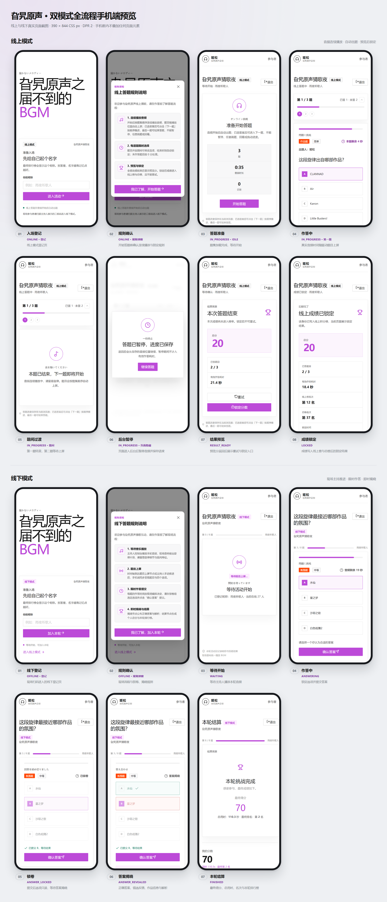

# 双模式全流程手机端预览图

## 1. 用途

本图用于活动筹备、联调与评审阶段核对参与者手机端在线上与线下两种模式下的页面顺序、状态切换与关键文案。

预览板中的手机画面来自实际运行的前端页面截图。截图视口为 390 × 844 CSS 像素，设备像素比为 2，输出尺寸为 780 × 1688。手机框只承担边界与标签功能，框内像素与前端页面渲染结果一致。



## 2. 画面范围

### 2.1 线上模式

| 序号 | 画面 | 入口或状态 | 画面来源 |
| :--- | :--- | :--- | :--- |
| 01 | 入场登记 | `/online?event=jisong` | 线上登记页首屏。 |
| 02 | 规则确认 | 登记页“规则须知”弹窗 | 线上规则弹窗。 |
| 03 | 答题准备 | `/play?event=jisong&mode=online`，`IDLE` | 题集加载完成且没有本地答题进度。 |
| 04 | 作答中 | `IN_PROGRESS`，第一题开放窗口 | 音频播放至第一题 `answerStartMs` 之后。 |
| 05 | 题间过渡 | `IN_PROGRESS`，第一题结束、第二题开始前 | 音频播放至第一题 `answerEndMs` 之后。 |
| 06 | 页面隐藏暂停 | 页面进入后台 | 作答中音频暂停，页面显示进度保存提示。 |
| 07 | 结果预览 | `RESULT_READY` | 本地进度恢复为结果状态，预览分接口返回分数。 |
| 08 | 成绩锁定 | `LOCKED` | 线上状态接口返回已锁定成绩。 |

### 2.2 线下模式

| 序号 | 画面 | 入口或状态 | 画面来源 |
| :--- | :--- | :--- | :--- |
| 01 | 线下登记 | `/?mode=offline` | 线下登记页首屏。 |
| 02 | 规则确认 | 登记页“规则须知”弹窗 | 线下规则弹窗。 |
| 03 | 等待开始 | `/play?event=jisong&mode=offline`，`WAITING` | 活动状态接口返回等待主持人推进。 |
| 04 | 作答中 | `ANSWERING` | 题目开放提交，页面显示四个选项与音频剩余时间。 |
| 05 | 锁卷 | `ANSWER_LOCKED` | 已提交答案，选项进入只读状态。 |
| 06 | 答案揭晓 | `ANSWER_REVEALED` | 正确选项与错选反馈同时呈现，并显示作品信息；出题人与提示自题目上屏起显示。 |
| 07 | 本轮结算 | `FINISHED` | 个人得分、总用时、最终名次与本轮排行榜。 |

主持人动作在画面状态中体现：开始播放、题目上屏、锁卷、揭晓答案与结束本轮。主持人控制台采用宽屏布局，不属于手机端预览范围。

## 3. 数据来源

截图脚本通过 Chrome DevTools Protocol 的 `Fetch` 域拦截 `/api/*` 请求，并返回与后端 DTO 字段一致的内存响应。前端源码不包含演示分支，生产构建也不加载截图脚本。

固定演示身份：

- `eventId`：`jisong`
- `participantId`：`p-preview-0001`
- `playerId`：`offline-preview-0001`
- `nickname`：`雨夜听歌人`

线上题集包含 3 道题，音频总长 35 秒。第一题开放窗口为 1 秒至 2 秒，第二题从 6 秒开始，第三题从 12 秒开始。模拟音频为 8 kHz、16 位、单声道 WAV，用于驱动真实 `<audio>` 元素的时间轴与页面状态。

线下活动状态响应覆盖 `WAITING`、`ANSWERING`、`ANSWER_LOCKED`、`ANSWER_REVEALED` 与 `FINISHED`，排行榜响应提供 4 名参与者。

## 4. 视觉规范

- 页面截图使用 390 × 844 视口与 DPR 2，不进行缩放、裁切或二次绘制。
- 手机框、步骤标签与背景属于预览板装饰层；页面内容全部位于截图内部。
- 拼板按模式分行排列，桌面宽度下线上 4 列、线下 4 列，窄屏下自动减少列数。
- 每台手机下方标注序号、画面名称与状态说明。
- 预览板背景使用中性浅灰，手机边框使用深色实体框，页面截图四周保留统一内边距。

## 5. 交付文件

| 文件 | 内容 |
| :--- | :--- |
| `docs/assets/preview/full-flow-mobile.png` | 线上与线下流程合并预览板。 |
| `docs/assets/preview/online-flow-mobile.png` | 线上模式预览板。 |
| `docs/assets/preview/offline-flow-mobile.png` | 线下模式预览板。 |
| `tools/mobile-flow-preview/capture-live.mjs` | 启动无头 Chrome、注入 API 响应、驱动页面状态并输出截图。 |
| `tools/mobile-flow-preview/build-sheet.mjs` | 将截图原图排入手机框并输出三种预览板。 |
| `tools/mobile-flow-preview/sheet.css` | 预览板、手机框与标签样式。 |

## 6. 生成方式

前端开发服务器运行于 `http://127.0.0.1:5173/` 时，在仓库根目录执行：

```bash
node tools/mobile-flow-preview/capture-live.mjs
node tools/mobile-flow-preview/build-sheet.mjs
```

`capture-live.mjs` 支持 `PREVIEW_BASE_URL` 指定前端地址，并支持 `CHROME_PATH` 指定浏览器可执行文件。脚本将截图与 `captures.json` 场景清单写入 `tools/mobile-flow-preview/.build/`。

`build-sheet.mjs` 读取 `.build/captures.json`，按模式分组生成合并板与单模式预览板，并在生成完成后删除 `.build/` 临时目录。

## 7. 维护规则

- 页面文案、状态名称或接口字段发生变化时，先更新本文档与 `docs/frontend/views-and-ui.md`，再同步截图脚本中的响应数据。
- 线上与线下流程的步骤顺序以当前页面状态机为准。
- 预览图中的分数、昵称、名次、人数与时间均为演示数据。
- 截图脚本只注入网络响应与浏览器存储，不修改生产页面布局。
